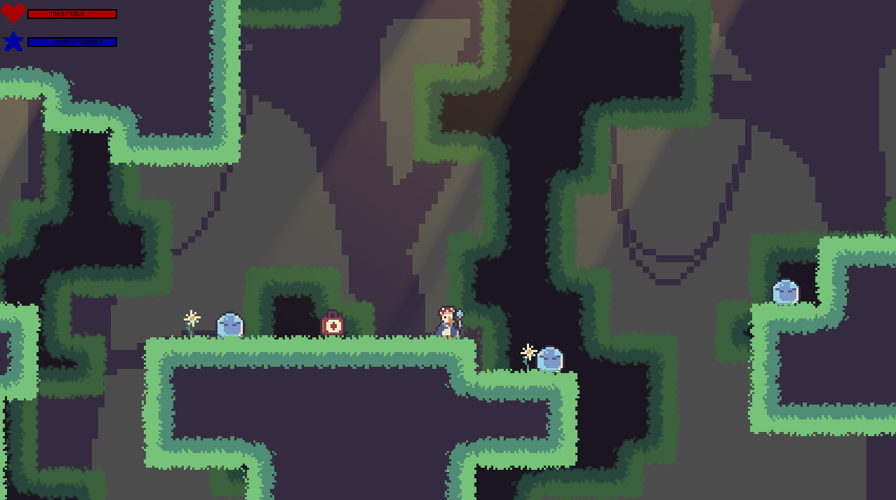

# Game Prototype

A small 2D platformer game made with Godot.

This is my first game using Godot, so the project is also a way for me to learn and experiment with game development.

All assets in this project were drawn by me.

The game is still a *work in progress*, and many things may change in the future.

## Controls

- **W** - Move up
- **A** - Move left
- **D** - Move right
- **Spacebar** - Dash

## Spells

- **Left Click** - Attack
- **F1** - Switch magic

## Development Log

### Latest Updates
- Added a new textures.
- Refactored the level.
- Improved enemies attack.

## Screenshot

- **Old**

- **New**

